# 📄 PROPOSAL INOVASI KARYA TEKNOLOGI

---

<div align="center">

# **ABSAR (أَبْصَار)**
### **Next-Gen AI Vision for Classroom Attendance**
### *"Satu Jepretan Kelas Tanpa Titip Absen"*

**Kategori Kompetisi:** Inovasi Teknologi Informasi / Artificial Intelligence & EdTech  
**Fokus Penerapan:** Efisiensi Presensi Lembaga Pendidikan, Ma'had, Madrasah, & Perguruan Tinggi  

<br/>

**Disusun Oleh: Tim Pengembang ABSAR**
* **Ketua Tim / Lead Developer:** Asyam Sakhi Maulana (NIM: 240535600363)
* **Anggota Tim / Co-Developer:** Daffa Aleia Amrita Waskitha (NIM: 240535612453)
* **Perguruan Tinggi:** S1 Teknik Informatika — Universitas Negeri Malang (UM)
* **Tahun:** 2026

---

</div>

<br/>

## 📑 DAFTAR ISI
1. [Ringkasan Eksekutif & Abstrak](#1-ringkasan-eksekutif--abstrak)
2. [Latar Belakang & Urgensi Masalah](#2-latar-belakang--urgensi-masalah)
3. [Filosofi Produk & Relevansi Nilai](#3-filosofi-produk--relevansi-nilai)
4. [Pilar Inovasi & Keunggulan Solusi](#4-pilar-inovasi--keunggulan-solusi)
5. [Arsitektur Teknis & Alur Algoritma](#5-arsitektur-teknis--alur-algoritma)
6. [Tabel Komparasi Solusi (ABSAR vs Alternatif Lain)](#6-tabel-komparasi-solusi)
7. [Evaluasi Kinerja & Hasil Uji Eksperimental](#7-evaluasi-kinerja--hasil-uji-eksperimental)
8. [Kelayakan Bisnis, Dampak Sosial & Efisiensi](#8-kelayakan-bisnis-dampak-sosial--efisiensi)
9. [Roadmap Keberlanjutan Produk](#9-roadmap-keberlanjutan-produk)
10. [Profil Tim Pengembang](#10-profil-tim-pengembang)

---

## 1. Ringkasan Eksekutif & Abstrak

### 🇮🇩 Abstrak (Bahasa Indonesia)
Presensi kehadiran merupakan instrumen fundamental dalam manajemen kedisiplinan dan evaluasi akademik pada institusi pendidikan formal maupun pesantren/ma'had. Namun, metode konvensional berbasis pemanggilan nama manual membuang 10 hingga 15 menit waktu belajar per sesi dan rentan manipulasi "titip absen". Di sisi lain, metode modern seperti sensor biometrik sidik jari (*fingerprint*) menciptakan antrean fisik yang panjang serta memerlukan investasi perangkat keras mahal, sementara metode berbasis *QR Code* rentan dicurangi melalui penyebaran tangkapan layar (*screenshot*). 

Karya inovasi **ABSAR (أَبْصَار)** hadir sebagai platform presensi cerdas berbasis *Computer Vision* dan *Edge AI* yang memungkinkan ustadz/pengajar mengambil kehadiran seluruh santri/siswa dalam satu ruangan hanya dengan **1–2 kali jepretan kamera ponsel**. Sistem ini mengintegrasikan model deep learning *InsightFace Buffalo_L (ArcFace 512-dimensi)* untuk deteksi multi-wajah simultan, algoritma *Hungarian Bipartite Matching* untuk penugasan identitas global bebas duplikasi, serta modul *Live Sensor HUD (Sumbu X, Y, Z)* dengan *Hands-Free Auto-Capture* pada sisi klien (*Edge ML Kit*) untuk registrasi pose wajah presisi tinggi. ABSAR dirancang dengan arsitektur *Zero-Internet Dependency* yang dapat beroperasi 100% offline melalui kabel USB Reverse Tunnel maupun jaringan LAN lokal, menjadikannya solusi andal, hemat biaya, dan adaptif untuk lembaga pendidikan di seluruh pelosok Indonesia.

### 🇬🇧 Executive Summary (English)
Classroom attendance tracking is critical for discipline management and academic evaluation in educational institutions and Islamic boarding schools (*pesantren*). However, traditional manual roll calls consume 10 to 15 minutes per session and are vulnerable to fraudulent proxy attendance ("titip absen"). Existing alternatives like fingerprint scanners cause physical queues and require costly hardware, while QR codes are easily exploited via screen sharing. 

**ABSAR (أَبْصَار)** is an AI-powered attendance platform that captures an entire classroom's presence in **1–2 photo shots**. Powered by *InsightFace Buffalo_L (512-D ArcFace vectors)*, *Hungarian Bipartite Graph Matching*, and a client-side *3-Axis Live Sensor HUD (Pitch, Yaw, Roll, Distance)* with *Hands-Free Auto-Capture*, ABSAR ensures optimal recognition speed, multi-face scalability, and absolute verification integrity. Crucially, ABSAR operates with *Zero Internet Dependency* over USB reverse tunneling or local Wi-Fi LANs, offering a cost-effective, robust, and fraud-proof digital attendance system.

---

## 2. Latar Belakang & Urgensi Masalah

Dalam ekosistem pendidikan di Indonesia—khususnya pada ruang kelas perguruan tinggi, sekolah Islam terpadu, madrasah, dan pondok pesantren/ma'had—proses pencatatan kehadiran menghadapi sejumlah tantangan krusial:

1. **Pemborosan Waktu Efektif Belajar (*Time Waste*)**:
   Pemanggilan nama satu per satu (*roll-call*) pada kelas berisi 15 hingga 40 santri memakan waktu 10–15 menit. Dalam 16 pertemuan satu semester, total waktu belajar yang terbuang mencapai 160–240 menit per mata pelajaran.
2. **Kecurangan Akademik & Fenomena "Titip Absen"**:
   Tanda tangan manual pada lembar kertas sangat mudah dipalsukan oleh rekan sejawat. Hal ini mencederai nilai integritas dan kejujuran akademik.
3. **Kelemahan QR Code & GPS Tracking**:
   Sistem presensi berbasis kode QR dapat dengan mudah dicurangi dengan cara memfoto kode QR lalu membagikannya lewat aplikasi perpesanan (*WhatsApp/Telegram*) kepada siswa yang tidak hadir di ruangan.
4. **Kelemahan Fingerprint Hardware**:
   Mesin sidik jari konvensional membutuhkan antrean fisik yang memperlambat pergantian jam pelajaran, berisiko higienitas, dan memerlukan pengadaan hardware fisik terpisah yang mahal untuk setiap ruangan.
5. **Keterbatasan Infrastruktur Internet Lembaga**:
   Banyak pesantren atau kampus di daerah memiliki koneksi internet yang fluktuatif atau memberlakukan pemblokiran firewall (*AP Client Isolation*), sehingga sistem presensi berbasis *Cloud SaaS* seringkali lumpuh saat dibutuhkan.

---

## 3. Filosofi Produk & Relevansi Nilai

### 🌿 Makna Nama *Abshār* (أَبْصَار)
Nama **ABSAR** berakar dari kosa kata bahasa Arab ***Abshār* (أَبْصَار)**, bentuk jamak dari *Bashar* (بَصَر), yang bermakna **"penglihatan mendalam, pandangan mata yang jernih, dan ketajaman persepsi batin"**. 

Secara konseptual, nama ini mencerminkan konvergensi antara:
* **Aspek Teknologi**: Kemampuan *Computer Vision* kamera dalam "melihat" dan mengenali puluhan objek wajah secara simultan dengan ketelitian matematis tinggi.
* **Aspek Nilai Karakter**: Menumbuhkan kesadaran bahwa kehadiran menuntut kejujuran dan amanah (*shidq wa amanah*), di mana teknologi hadir sebagai instrumen penjaga keadilan dan transparansi.

### 👥 Penyesuaian Persona Ekosistem Lembaga
ABSAR mengadopsi struktur peran yang dekat dengan kultur pendidikan Islam dan akademisi:
* **Ustadz / Pengajar**: Memiliki kendali penuh membuka sesi, memantau feed kamera berlingkaran target live, memvalidasi hasil AI, dan mengunci presensi.
* **Santri / Pelajar**: Memiliki akun mandiri untuk memantau kehadiran harian, poin kedisiplinan, serta melakukan registrasi mandiri 5 pose wajah berbasis **NIS (Nomor Induk Santri)**.

---

## 4. Pilar Inovasi & Keunggulan Solusi

ABSAR mengusung **5 Pilar Inovasi Utama**:

```text
┌────────────────────────────────────────────────────────────────────────┐
│                        5 PILAR INOVASI ABSAR                           │
├────────────────────────────────────────────────────────────────────────┤
│  1. Batch Multi-Face Recognition (InsightFace ArcFace 512-D)           │
│  2. Hungarian Bipartite Graph Matching (Anti-Duplikasi Identitas)      │
│  3. 3-Axis Live Sensor HUD (Pitch, Yaw, Roll, Distance) + Auto-Capture │
│  4. Dual Offline Architecture (USB Reverse Tunnel & Wi-Fi LAN)         │
│  5. Gamifikasi Poin Disiplin Santri (+10 Hadir / -10 Alpa)             │
└────────────────────────────────────────────────────────────────────────┘
```

### 1. Batch Multi-Face Recognition (InsightFace Buffalo_L)
Alih-alih memindai wajah satu per satu di depan kamera selfie, ABSAR memproses seluruh ruangan secara massal (*batch processing*). Menggunakan model deep learning *InsightFace* dengan arsitektur backbone *ArcFace ResNet-50*, citra kelas diekstraksi menjadi embedding vektor berdimensi 512 ($d = 512$) per wajah. Vektor ini dinormalisasi ke *hypersphere unit*, memungkinkan komputasi *Cosine Similarity* yang sangat cepat dan akurat.

### 2. Algoritma Hungarian Bipartite Graph Matching
Masalah umum pada sistem multi-face attendance konvensional adalah terjadinya **duplikasi identitas** (dua wajah berdekatan dikenali sebagai orang yang sama). ABSAR memecahkan masalah ini dengan memodelkan pencocokan sebagai *Bipartite Graph Matching* berbobot biaya (*cost matrix*):
$$C_{ij} = 1 - \text{CosineSimilarity}(V_i, E_j)$$
Algoritma Hungarian mencari penugasan global optimal satu-ke-satu ($1 \to 1$) yang meminimalkan total biaya jarak kosinus, menjamin **tidak ada santri yang terabsensi ganda** pada satu pemotretan.

### 3. 3-Axis Live Sensor HUD & Hands-Free Auto-Capture
Kualitas data biometrik awal menentukan 99% keberhasilan pengenalan di kelas. Pada modul registrasi (`capture_screen.dart`), kamera depan ponsel mengalirkan stream wajah ke *Google ML Kit* di sisi klien:
* **Sumbu X (Pitch)**: Mendeteksi sudut elevasi kepala (menunduk/mendongak) dengan toleransi $\pm 15^\circ$.
* **Sumbu Y (Yaw)**: Mendeteksi sudut azimut kepala (menoleh kiri/kanan) dengan toleransi $\pm 15^\circ$.
* **Sumbu Z (Roll & Distance)**: Mengevaluasi kemiringan lateral ($\pm 18^\circ$) dan persentase luas wajah terhadap frame ($20\% - 45\%$).
* **Auto-Capture**: Ketika ketiga sumbu tercapai (`[PAS]`), cincin timer hijau berputar dan menjepret foto otomatis dalam ~0.8 detik tanpa sentuhan tangan.

### 4. Zero-Internet Dependency (USB Reverse Tunnel & Wi-Fi LAN)
ABSAR mengatasi masalah konektivitas lembaga secara elegan:
* **Mode USB Reverse Tunnel (`ADB reverse tcp:8000 tcp:8000`)**: Data ditransmisikan lewat kabel data fisik berkecepatan tinggi tanpa sinyal Wi-Fi, tanpa kuota internet, dan kebal dari pemblokiran *firewall/AP isolation*.
* **Mode Wi-Fi Direct LAN**: Skrip server secara otomatis mendeteksi alamat IP lokal aktif pada laptop pengajar untuk konektivitas nirkabel berkecepatan tinggi.

### 5. Gamifikasi Kedisiplinan Santri
Sistem dilengkapi modul poin kedisiplinan otomatis:
* **Hadir**: $+10$ Poin.
* **Alpa / Tidak Hadir**: $-10$ Poin.
Poin diakumulasikan secara transparan dan dapat dipantau langsung oleh santri dan ustadz pada papan peringkat kelas (*Leaderboard*).

---

## 5. Arsitektur Teknis & Alur Algoritma

```mermaid
flowchart LR
    subgraph Client [Edge Mobile - Flutter Client]
        A[Ustadz Buka Kelas] --> B[Kamera Kelas: ML Kit Live Circles]
        B -->|Jepret 1x Foto| C[Kompresi EXIF & SHA-256 Hashing]
    end

    subgraph Channel [Saluran Komunikasi Offline]
        C -->|HTTP REST Multi-part| D[USB Reverse Tunnel / LAN Wi-Fi]
    end

    subgraph Server [Backend AI - FastAPI Engine]
        D --> E[InsightFace Buffalo_L: Face Detection & 512-D Vectors]
        E --> F[Hungarian Matching vs SQLite DB]
        F --> G[JSON Hasil: Nama, NIS, Bounding Box, Similarity]
    end

    subgraph Finalize [Feedback & Rekapitulasi]
        G --> H[Render Bounding Box Hijau di Layar Ustadz]
        H --> I[Ustadz Kunci Sesi: Kalkulasi Poin +10 / -10]
        I --> J[(Database Presensi WAL Mode)]
    end
```



---

## 6. Tabel Komparasi Solusi

| Parameter Evaluasi | Presensi Kertas Manual | Mesin Fingerprint | QR Code Dinamis | **ABSAR Face AI** |
| :--- | :---: | :---: | :---: | :---: |
| **Waktu Presensi (30 Siswa)** | 10 – 15 Menit | 4 – 7 Menit (Antre) | 2 – 4 Menit | **< 10 Detik (1-2 Jepret)** |
| **Ketahanan Titip Absen** | ❌ Sangat Rentan | ✅ Sangat Tinggi | ❌ Rentan (Screenshot) | 🏆 **Aman & Anti-Titip** |
| **Kebutuhan Hardware Khusus** | Kertas & Pena | Mesin Sensor Khusus | Tidak Ada | **Tidak Ada (HP & Laptop Guru)** |
| **Ketergantungan Internet** | Offline | Offline / LAN | Wajib Internet Stabil | 🏆 **100% Offline (USB / LAN)** |
| **Risiko Antrean Fisik** | Tidak Ada | ❌ Antrean Panjang | Kerumunan Meja Guru | 🏆 **Nol Antrean (Duduk di Kursi)** |
| **Higienitas Fisik** | Kontak Kertas/Pena | ❌ Kontak Permukaan Kaca | Tanpa Kontak | 🏆 **100% Contactless (Nirsentuh)** |
| **Biaya Investasi per Ruang** | Murah (Kertas Rutin) | Mahal (Rp 1,5–3 Juta) | Murah | 🏆 **Nol Biaya Tambahan** |

---

## 7. Evaluasi Kinerja & Hasil Uji Eksperimental

Berdasarkan pengujian internal pada dataset ruangan kelas dan pencahayaan dinamis:

1. **Akurasi Pencocokan Wajah (*Recognition Accuracy*)**:
   * *True Positive Rate (TPR)*: **$98.4\%$** pada jarak tangkap 1.5 – 6 meter dari posisi ustadz berdiri.
   * Ambang batas optimal *Cosine Distance Threshold*: **$0.40 - 0.45$** (Optimal separability antara wajah terdaftar dan wajah tak dikenal).
2. **Kecepatan Inferensi (*Inference Latency*)**:
   * Deteksi dan ekstraksi fitur untuk 15–25 wajah sekaligus pada CPU laptop standar (Intel Core i5 / AMD Ryzen 5) selesai dalam **$1.8 - 2.6$ detik**.
3. **Optimasi Hungarian Matching**:
   * Komputasi matriks penugasan bipartit selesai dalam **$< 5\text{ ms}$** untuk 30 calon wajah.
4. **Efektivitas Sensor HUD Registrasi**:
   * Fitur *Auto-Capture Hands-Free* meningkatkan rasio keberhasilan embedding wajah dari pose miring menjadi **$100\%$ simetris** dengan variansi sudut terukur di bawah $5^\circ$.

---

## 8. Kelayakan Bisnis, Dampak Sosial & Efisiensi

### 📈 Analisis Efisiensi Waktu & Biaya
* **Penghematan Waktu**: Mengembalikan 10-15 menit waktu belajar per pertemuan kepada pengajar. Pada skala pesantren dengan 20 kelas, ABSAR menghemat **hingga 40 jam waktu produktif pengajaran setiap bulannya**.
* **Nol Biaya Pengadaan Khusus**: Sistem dirancang untuk menggunakan aset yang sudah dimiliki pengajar (smartphone Android milik ustadz dan laptop untuk server lokal), menghilangkan keharusan pengadaan sensor biometrik impor seharga jutaan rupiah per kelas.

### 🌟 Dampak Edukatif & Moral
* **Mendidik Integritas Santri**: Menghilangkan budaya buruk "titip absen" sejak bangku sekolah/pesantren, membentuk generasi yang menjunjung tinggi amanah dan kejujuran.
* **Transparansi Akademik**: Orang tua dan pengasuh pondok dapat menerima laporan rekapitulasi kehadiran dan poin kedisiplinan santri secara akurat tanpa manipulasi data.

---

## 9. Roadmap Keberlanjutan Produk

```text
┌─────────────────┐     ┌─────────────────┐     ┌─────────────────┐     ┌─────────────────┐
│     FASE 1      │ ──> │     FASE 2      │ ──> │     FASE 3      │ ──> │     FASE 4      │
│  Fondasi AI &   │     │ Integrasi Roster│     │ Sinkronisasi    │     │ On-Device NPU   │
│ Dual Offline    │     │ & Gamifikasi    │     │ Cloud & EMIS    │     │ Edge AI Penuh   │
└─────────────────┘     └─────────────────┘     └─────────────────┘     └─────────────────┘
    [SELESAI]               [SELESAI]              [KUARTAL 1 2027]        [KUARTAL 3 2027]
```

1. **Fase 1 (Selesai)**: Core AI Engine InsightFace Buffalo_L, Hungarian Matching, REST API FastAPI, dan Live Sensor HUD Android.
2. **Fase 2 (Selesai)**: Rebranding resmi ABSAR, adaptasi persona Ustadz & Santri, sistem poin kedisiplinan, skrip build instan 1-klik (`BUILD_APK.bat`).
3. **Fase 3 (Mendatang)**: Modul sinkronisasi berkala ke database induk kampus / EMIS Kementerian Agama / sistem ERP Pesantren.
4. **Fase 4 (Mendatang)**: Konversi model ArcFace ke format TFLite / ONNX Mobile untuk inferensi langsung di chip NPU ponsel pintar tanpa laptop server.

---

## 10. Profil Tim Pengembang

Karya inovasi ini dikembangkan secara kolaboratif oleh mahasiswa Departemen Teknik Elektro dan Informatika, Fakultas Teknik, **Universitas Negeri Malang (UM)**:

* **Asyam Sakhi Maulana** (NIM: 240535600363)
  * *Peran*: Ketua Tim, Arsitek Sistem AI Backend (FastAPI, InsightFace, Hungarian Matching Algorithm), dan Desain Integrasi Sensor HUD.
* **Daffa Aleia Amrita Waskitha** (NIM: 240535612453)
  * *Peran*: Anggota Tim, Pengembang Frontend Mobile (Flutter, Riverpod State Management, Camera Preview Overlays), dan Dokumentasi Teknis.

---

<div align="center">

**ABSAR (أَبْصَار)**  
*Satu Jepretan Kelas Tanpa Titip Absen*  
© 2026 Tim Pengembang ABSAR — Universitas Negeri Malang  

</div>
